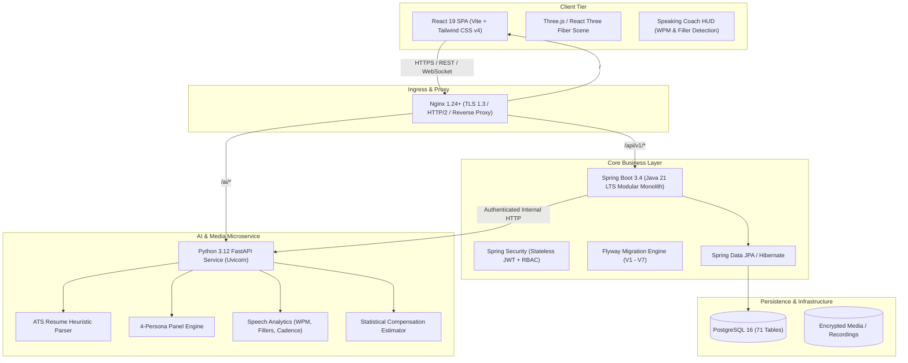

# InterviewOS - Comprehensive System Architecture Document

## 1. Executive Summary

**InterviewOS** is an intelligent, multi-tier AI interview preparation, interview intelligence, and recruitment SaaS platform. It combines automated resume parsing, real-time speaking coaching, an interactive 4-persona executive interview panel, longitudinal weakness detection, statistical salary intelligence, and an enterprise recruiter portal.

The architecture emphasizes:
- **Strict Light Theme UI/UX**: Professional, enterprise-grade slate and cobalt design tokens with zero dark mode or neon gimmicks.
- **Non-Docker Production Readiness**: Native systemd services, G1GC-tuned JVM parameters, Uvicorn multi-worker orchestration, and hardened Nginx reverse proxy.
- **Relational Data Integrity**: 7 Flyway database migrations establishing 71 PostgreSQL tables with idempotent index creation.
- **Multi-Persona AI Orchestration**: Real-time cross-examination simulating 4 distinct interview personas (Talent Director, Staff Tech Lead, VP Engineering, and Chief Enterprise Architect).

---

## 2. High-Level Architecture Diagram

---

## 3. Technology Stack Breakdown

| Layer | Technologies Selected | Rationale & Capabilities |
| :--- | :--- | :--- |
| **Frontend** | React 19, TypeScript, Vite, Tailwind CSS v4, Lucide React, Three.js, React Three Fiber, Recharts, TanStack Query | Ultra-fast SPA compilation, strict TypeScript safety, interactive 3D hero visualization, responsive dashboard widgets. |
| **Core Monolith** | Java 21 LTS, Spring Boot 3.4.2, Spring Security, Spring Data JPA, Hibernate, Bean Validation | Strong typing, enterprise-grade RBAC, modular package structure, out-of-the-box OpenAPI documentation. |
| **AI Microservice** | Python 3.12, FastAPI, Uvicorn, Pydantic v2, Pytest | Asynchronous high-throughput AI orchestration, STAR rubric evaluations, NLP text processing. |
| **Database** | PostgreSQL 16, Flyway (7 migrations) | Relational integrity, JSONB support for unstructured rubrics, transactional ACID safety. |
| **Deployment** | Linux systemd, Nginx, non-Docker architecture | High performance, direct hardware memory utilization, zero Docker runtime overhead. |

---

## 4. Database Schema Ownership (7 Flyway Migrations)

1. `V1__init_identity_and_tenancy.sql`:
   - `users`, `roles`, `permissions`, `user_roles`, `user_profiles`, `user_settings`, `organizations`, `refresh_tokens`, `audit_logs`
2. `V2__init_resumes_and_jobs.sql`:
   - `resumes`, `resume_parse_results`, `resume_skills`, `resume_projects`, `companies`, `job_postings`, `applications`
3. `V3__init_interview_engine_and_panel.sql`:
   - `interview_sessions`, `session_questions`, `session_answers`, `session_rubrics`, `rubric_scores`, `session_feedback`, `panel_personas`, `panel_turns`, `session_reports`
4. `V4__init_media_and_speech.sql`:
   - `recording_assets`, `recording_consents`, `transcripts`, `transcript_segments`, `speech_metrics`
5. `V5__init_improvement_and_salary.sql`:
   - `skill_taxonomy`, `candidate_skills`, `identified_weaknesses`, `career_roadmaps`, `roadmap_milestones`, `coding_challenges`, `salary_observations`
6. `V6__init_recruiter_and_platform_operations.sql`:
   - `recruiter_jobs`, `recruiter_candidate_links`, `evaluation_scorecards`, `subscriptions`, `feature_flags`
7. `V7__seed_development_fixtures.sql`:
   - Seeded standard roles, 4 AI personas, demo accounts:
     - `candidate@interviewos.dev` / `Password123!`
     - `recruiter@interviewos.dev` / `Password123!`
     - `admin@interviewos.dev` / `Password123!`

---

## 5. Security & Privacy Model

- **Biometric Audio/Video Protections**: Recordings and camera feeds are private by default, stored in tenant-isolated encrypted storage, and never shared without explicit candidate consent.
- **Stateless RBAC**: JWT Bearer tokens with HMAC-SHA256 signatures, short-lived access tokens (15m), and rotating refresh tokens.
- **Network Isolation**: Python AI service binds strictly to `127.0.0.1:8000`, accepting internal requests only from Spring Boot or authenticated Nginx internal proxies.
